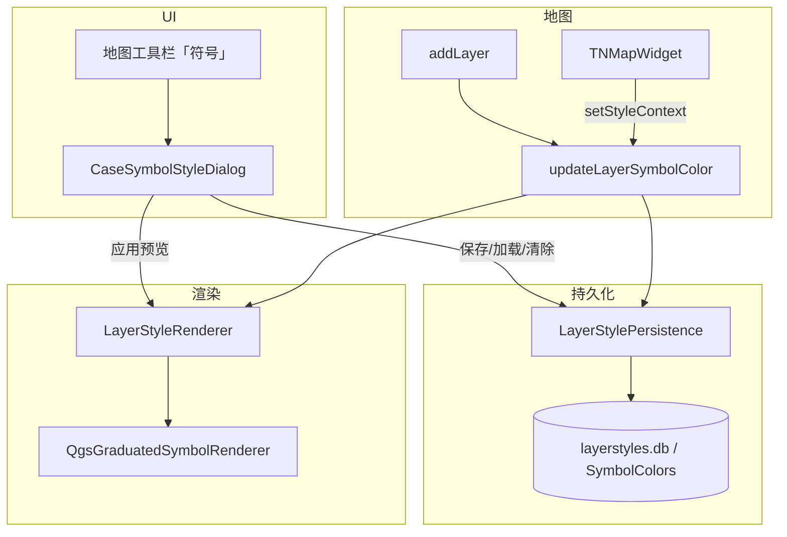

# 字段分级符号化

本文档描述 Phase2 中 **按数字字段分级渲染矢量图层** 的设计与实现，对齐 Phase1 `SymbolColorSetPanel` + `SymbColorsSave2DB` 的行为。

**相关源码：**

| 模块 | 路径 |
|------|------|
| 符号化弹窗 | `src/casectrls/casesymbolstyledialog.h/.cpp` |
| 样式持久化 | `src/tnmapwidget/layerstylepersistence.h/.cpp` |
| 渲染器应用 | `src/tnmapwidget/layerstylerenderer.h/.cpp` |
| 自动恢复 | `src/tnmapwidget/tnmapwidget.cpp` → `updateLayerSymbolColor`、`setStyleContext` |
| 入口 | `src/casectrls/casemaptoolcontroller.cpp` → `runSymbol` |
| 上下文传播 | `src/uis/casepanel.cpp`（基础数据 / 方案详情 / 双屏对比地图） |

**Phase1 参考：** `Phase1/src/uis/symbolcolorsetpanel.cpp`、`Phase1/src/toolboxmanage/symbcolorssave2db.cpp`、`Phase1/src/tnmapwidget/tnmapwidget.cpp`（`UpdateLayerFeatures`）。

**与样式工厂的关系：** 业务默认样式见 [`layer-style-factory.md`](layer-style-factory.md)。字段样式在图层 `addLayer` 末尾由 `updateLayerSymbolColor` **覆盖**已保存规则；无已存规则时保留工厂/几何默认符号。

---

## 1. 背景与目标

Phase2 早期符号化弹窗以 SLD（QSettings）手动存取为主，无法像 Phase1 一样按数字字段生成分级色带并自动恢复。

2026-07 重构后目标：

1. 弹窗可选择 **数字类型字段**，按字段值生成分级渲染（`QgsGraduatedSymbolRenderer`）。
2. 规则以 JSON 存入本地 SQLite，按 `project_id` + `case_id` + `layer_key` + `field_name` 分区。
3. 图层加载后 **自动恢复**该图层最近一次保存的字段样式。
4. 移除 SLD 保存/加载 UI 与持久化逻辑（不再使用 QSettings 存 SLD）。

---

## 2. 架构分层



| 组件 | 职责 |
|------|------|
| **`CaseSymbolStyleDialog`** | 字段/分级/色带/反转/透明度/线宽 UI；生成预览规则；保存与清除 |
| **`SymbolRendererConfig`** | 预置色带工厂（`createColorRamp` / `availableColorRampNames`） |
| **`LayerStylePersistence`** | `FieldColorRule` JSON 序列化；SQLite CRUD |
| **`LayerStyleRenderer`** | 将 `FieldColorRule` 转为 QGIS 渲染器并 `setRenderer` |
| **`TNMapWidget::setStyleContext`** | 绑定 `projectId`、`caseId`，供自动恢复查询 |
| **`TNMapWidget::updateLayerSymbolColor`** | 图层加入地图后加载 **最新一条** 字段规则并应用 |

---

## 3. 样式上下文（projectId / caseId）

字段样式按项目与方案隔离，与 API `case_id` 约定一致（见 [`README.md`](README.md)）：

| 地图场景 | `caseId` |
|----------|----------|
| 基础数据侧栏地图 | `0` |
| 方案详情 / 双屏对比 | 真实方案 id |

`CasePanel` 在以下时机调用 `TNMapWidget::setStyleContext(projectId, caseId)`：

- `setProjectId`
- 创建基础数据地图 `m_baseMapWidget`
- 打开方案、勾选 WFS 图层、双屏对比切换
- `applyCaseTreeWfsToMap`、`onBaseDataLayerCheckChanged`

打开符号化弹窗前，`CaseMapToolController::runSymbol` 也会设置一次上下文。

**注意：** `projectId <= 0` 或 `caseId < 0` 时 `updateLayerSymbolColor` 直接返回，不尝试恢复。

---

## 4. 图层存储键（layer_key）

`LayerStylePersistence::layerStorageKey(layer)` 从数据源 URI 解析，优先级：

1. `uri.table()`（WFS/PostGIS 表名）
2. URI 参数 `typename` / `typeName`
3. 图层 `name()`

与 Phase1 按表名存规则的方式一致，兼容带工程前缀的 WFS typename。

---

## 5. 数据结构

### FieldColorRule

| 字段 | 说明 |
|------|------|
| `category` | `Number` / `Bool` / `String`（弹窗当前主要用 `Number`） |
| `opacity` | 0–100，写入符号透明度 |
| `lineWidth` | 线宽（点/线/面描边），新建规则默认 **0.8** |
| `classLevel` | 分级数（默认 5） |
| `colorRampName` | 预置色带名（默认 `RdYlGn`）；旧 JSON 缺省时按默认解析 |
| `rampInverted` | 是否反转色带采样（默认 `false`） |
| `colors` | `FieldColorRuleItem` 列表（**烘焙色**，渲染与自动恢复的唯一颜色来源） |

### FieldColorRuleItem（数字分级）

| 字段 | 说明 |
|------|------|
| `color` | `#rrggbb` |
| `min` / `max` | 分级区间上下界 |

JSON 存于表字段 `color_value`，由 `FieldColorRule::toJsonString()` / `fromJsonString()` 读写。表结构不变；色带元数据与烘焙色一并写入 JSON。

预置色带（`SymbolRendererConfig::availableColorRampNames`）：`RdYlGn` / `Reds` / `Spectral` / `RdYlBu` / `Blues` / `YlOrRd` / `YlGnBu` / `PuBuGn`。

---

## 6. 本地数据库

| 项 | 值 |
|----|-----|
| 默认路径 | `{exe目录}/data/layerstyles.db` |
| 表名 | `SymbolColors` |
| 唯一键 | `(project_id, case_id, layer_key, field_name)` |

建表语句（摘要）：

```sql
CREATE TABLE IF NOT EXISTS SymbolColors (
    id INTEGER PRIMARY KEY AUTOINCREMENT,
    project_id INTEGER NOT NULL,
    case_id INTEGER NOT NULL DEFAULT 0,
    layer_key TEXT NOT NULL,
    field_name TEXT NOT NULL,
    color_value TEXT NOT NULL,
    created_time DATETIME DEFAULT CURRENT_TIMESTAMP,
    updated_time DATETIME DEFAULT CURRENT_TIMESTAMP,
    UNIQUE(project_id, case_id, layer_key, field_name)
);
```

- **保存：** `INSERT OR REPLACE`，更新 `updated_time`
- **自动恢复：** `loadLatestFieldColorRule` 按 `updated_time DESC, id DESC` 取该图层 **最新一条** 记录（不限定字段名）

---

## 7. 分级颜色生成（弹窗）

`CaseSymbolStyleDialog::generateFieldColorRule()`：

1. 遍历图层要素，收集当前数字字段的非空值，排序去重。
2. 在 `[min, max]` 上按 `classLevel` **等距分段**。
3. 按当前 `colorRampName` 创建 `QgsGradientColorRamp`；若勾选反转则 `invert()`。
4. 对第 `i` 级采样 `t = i / (n - 1)`（`n == 1` 时 `t = 0`），写入各级 `color`（与 `LayerStyleFactory` 一致）。

特殊：全部要素同值时只生成单级。

加载旧样式（无 `colorRampName` / `rampInverted`）时：UI 显示默认色带与未反转，**不重算**已烘焙的 `colors`。

### 应用时机对比

| 操作 | 是否重新 `generateFieldColorRule` | 说明 |
|------|-----------------------------------|------|
| 改色带 / 反转 / 分级数 | 是 | 重算各级颜色并立即预览 |
| 改透明度 / 线宽 | 否 | 只更新规则参数并 `applyCurrentFieldRule` |
| 点击分级列表改单色 | 否 | 保留手动调色，立即预览 |
| 点击「应用」 | 仅规则无效时生成 | 应用当前 `m_fieldRule`，不强制重算 |
| 「保存字段样式」 | 同「应用」后再写库 | 持久化当前规则（含色带元数据与烘焙色） |

两者最终都调用 `LayerStyleRenderer::applyFieldColorRule`（渲染层不读取色带名，只消费 `colors`）。

---

## 8. QGIS 渲染器

`LayerStyleRenderer::applyFieldColorRule`：

| `category` | 渲染器 |
|------------|--------|
| `Number` | `QgsGraduatedSymbolRenderer`（`Qgis::GraduatedMethod::Color`） |
| `Bool` / `String` | `QgsCategorizedSymbolRenderer`（结构已预留，弹窗暂未暴露） |

符号取自 `QgsSymbol::defaultSymbol(geometryType)`，再 `setColor` + `configureSymbol(opacity, lineWidth)`。

---

## 9. 符号化弹窗 UI

入口：方案详情 / 基础数据地图工具栏 → **符号** → `CaseSymbolStyleDialog`（`FramelessDialog`）。

布局要点：

- 上部：图层、数字字段、分级数、透明度、线宽（默认 0.8）、色带下拉（带渐变预览）、反转色带、分级颜色列表（色块图标 + 文字）
- 中部按钮：`保存字段样式` | `加载字段样式` | `清除字段样式` | `编辑单符号`
- 底部一行：状态 `QLabel`（拉伸）| `应用` | `关闭`

| 按钮 | 行为 |
|------|------|
| 应用 | 将当前规则渲染到地图（不写入数据库） |
| 保存字段样式 | 应用后 `saveFieldColorRule` |
| 加载字段样式 | 从库读取 **当前字段** 的规则 |
| 清除字段样式 | 删除当前字段记录，图层恢复几何默认符号 |
| 编辑单符号 | 仅当渲染器为 `QgsSingleSymbolRenderer` 时打开 QGIS 符号编辑器；分级渲染请用字段样式 |

**已移除：** 「保存 SLD」「加载 SLD」及 `LayerStylePersistence` 中全部 SLD API。

---

## 10. 图层加载时的样式优先级

`TNMapWidget::addLayer` 末尾调用 `updateLayerSymbolColor`：

```
几何默认符号（或 LayerStyleFactory 业务样式）
    ↓ 若存在已存字段规则
字段分级样式（覆盖前述渲染器）
```

因此用户保存的字段样式在重新勾选 WFS 图层后仍会恢复；未保存时保持工厂/默认符号。

---

## 11. 验证清单

1. 编译通过（`layerstylepersistence`、`layerstylerenderer`、`casesymbolstyledialog` 已加入工程）
2. 打开项目 → 勾选矢量图层 → 工具栏「符号」→ 选择数字字段 → 地图出现分级着色
3. 「保存字段样式」后取消勾选再勾选同一图层 → 自动恢复分级样式
4. 基础数据地图保存的样式在 `case_id=0` 下读取；方案地图使用对应 `case_id`，互不干扰
5. 「清除字段样式」后恢复几何默认符号（线图层黑线 0.6pt / 点 `#ff5a5f` size 1.6）
6. 打开符号化弹窗时线宽默认 0.8；改色带 / 勾选反转可即时预览；单独改某级颜色后点「应用」不重算整条色带
7. 加载无色带元数据的旧样式不改变已烘焙颜色；再改色带后保存可写入新元数据
8. `data/layerstyles.db` 在首次保存时自动创建

---

## 12. 后续扩展

- 弹窗支持布尔/字符串字段分类渲染（`LayerStyleRenderer` 已支持）
- 与 `LayerStyleFactory` 协调「分析专用样式 vs 用户字段样式」优先级策略
- 方案导出时是否携带 `layerstyles.db` 或改为服务端同步（当前仅本地）
