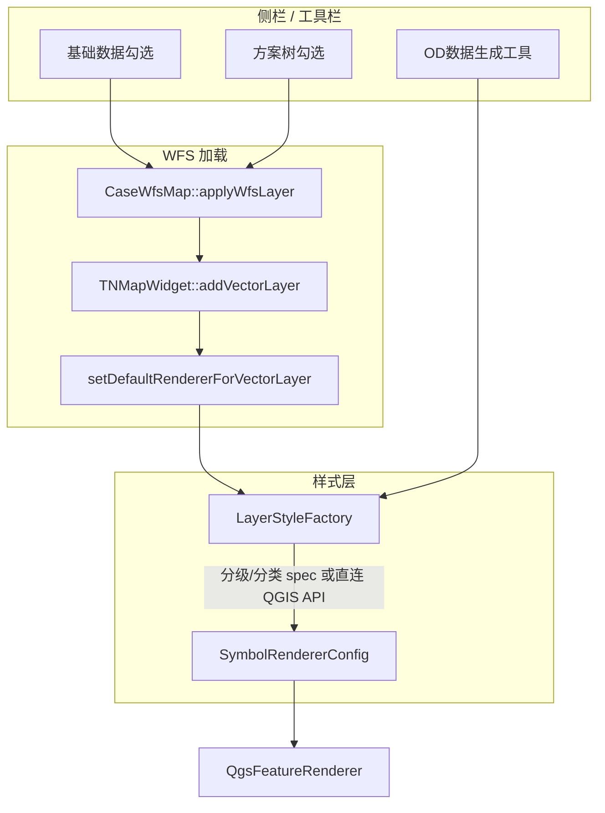

# 图层样式工厂（LayerStyleFactory）

本文档描述 Phase2 客户端中 **按图层类型自动/手动应用 QGIS 渲染样式** 的设计与实现，对齐 Phase1 中 OD 分布等分析工具的符号化规则。

**相关源码：**

| 模块 | 路径 |
|------|------|
| 样式工厂 | `src/tnmapwidget/layerstylefactory.h/.cpp` |
| 渲染器构建 | `src/tnmapwidget/symbolrendererconfig.h/.cpp` |
| 几何默认符号 | `src/tnmapwidget/tnmapwidget.cpp` → `setDefaultRendererForVectorLayer` |
| WFS 加载接入 | `src/casectrls/casewfsmapcontroller.cpp` → `CaseWfsMap::applyWfsLayer` |
| 路段层 type 过滤 | `src/casectrls/casewaylayerhelper.h/.cpp`（见 [`layer-filter.md`](layer-filter.md)） |
| 分析上图 | `src/uis/casepanel.cpp` → `applyAnalysisResultOnMap` |
| 侧栏联动 | `src/uis/casepanel.cpp` |

**Phase1 参考：** `Phase1/src/uis/bearinganalysistoolbarwidget.cpp`（`onLuWangXZFXODDist`）、`Phase1/src/tnmapwidget/symbolrendererconfig.cpp`。

---

## 1. 背景与目标

Phase2 通过 WFS 加载矢量图层后，原先仅按 **几何类型**（点/线/面）设置单一默认符号，无法区分 `other_od`、`road_way` 等业务图层。

目标：

1. 提供 **样式工厂** `LayerStyleFactory`，按图层类型 `val` 或 WFS `typename` 分发默认样式。
2. 对外暴露 **指定样式** 接口，供工具栏按钮、分析流程等按需调用。
3. **OD 分布样式**：仅在基础数据侧栏 **「OD数据生成」** 工具调用 `/api/grpc/runalg`（`type=tool`，`type2=trip_model_all`）成功后，对 `other_od` 图层按 `demand` 应用分类符号化、`Reds` 色带和升序要素渲染顺序；**勾选加载图层时不再自动应用**。
4. **路段分析样式**：基础方案工作台 **路网流量分布** / **交通饱和度** 上图时，对 `road_way` / `bus_way` / `slow_road_way` 按 `volume` 或 `saturation_edit` 应用分级符号（三模块均为 RdYlGn 等距 5 级 / 饱和度固定区间，线宽 0.6pt）；须先 `CaseWayLayer::clearTypeFilter` 解除默认 `"type" < 10` 过滤。

---

## 2. 架构分层



| 类 | 职责 |
|----|------|
| **`TNMapWidget::setDefaultRendererForVectorLayer`** | 未知图层类型的几何默认符号（点 `#ff5a5f` size 1.6、线纯黑 0.6pt、面浅灰） |
| **`LayerStyleFactory`** | 业务策略：识别图层类型、读字段统计、生成样式并应用 |
| **`SymbolRendererConfig`** | 底层：根据 `QVariantMap spec` 构建 `QgsSingleSymbolRenderer` / `QgsGraduatedSymbolRenderer` 等 |

工厂 **不替代** 几何默认符号：先由 `addLayer` 设置默认符号，再由工厂对已知 `val`/`typename` **覆盖** 为专用样式。

---

## 3. 图层类型识别

侧栏节点携带两类标识（见 `docs/api.md` 中 `menu[]` / `list[]` 说明）：

| 字段 | 含义 | 示例 |
|------|------|------|
| `val` | 表类型键（API `children[].val`） | `other_od` |
| `value` / `typename` | WFS 全名 | `project22_user1_other_od` |

`LayerStyleFactory::isOtherOdLayer(layerVal, typeName)` 满足 **任一** 条件即视为 OD 图层：

1. `layerVal` 等于 `other_od`（忽略大小写）
2. `typeName` **以** `other_od` **结尾**（忽略大小写），兼容带工程号、用户号前缀的 WFS 表名

后续扩展其他图层（如 `road_way`、`slow_other_od`）时，在工厂内增加同类识别函数或在 `applyDefaultStyle` 中增加分支即可。

---

## 4. 公共 API

```cpp
class LayerStyleFactory {
public:
    // 是否 OD 图层（val 或 typename 后缀）
    static bool isOtherOdLayer(const QString& layerVal, const QString& typeName = QString());

    // 按图层类型应用默认样式；返回 true 表示已应用专用样式
    static bool applyDefaultStyle(QgsVectorLayer* layer, const QString& layerVal,
                                  const QString& typeName = QString());

    // 按预设 key 应用指定样式（工具栏 / 按钮）
    static bool applyStyle(QgsVectorLayer* layer, const QString& styleKey);

    // 通过地图 dataSourceUri 查找图层后应用
    static bool applyDefaultStyle(TNMapWidget* map, const QString& dataSourceUri,
                                  const QString& layerVal, const QString& typeName = QString());

    // other_od：按 demand 唯一值分类，Reds 色带，demand 升序渲染
    static bool applyOtherOdDemandStyle(QgsVectorLayer* layer);
    static QVariantMap createOtherOdDemandSpec(QgsVectorLayer* layer);

    // 路段层：路网流量分布（volume；可指定色带与等数量/等距）/ 交通饱和度（saturation_edit 固定区间）
    static bool applyTrafficFlowStyle(QgsVectorLayer* layer,
                                      const QString& colorRampName = QStringLiteral("RdYlGn"),
                                      bool useEqualCount = false);
    static bool applyTrafficSaturationStyle(QgsVectorLayer* layer);
    static bool applyPathTraceStyle(QgsVectorLayer* layer);

    // 通用：字段 min/max、等距分级 spec（供扩展或其它模块复用）
    static bool fieldMinMax(QgsVectorLayer* layer, const QString& field, double& min, double& max);
    static QVariantMap createGraduatedEqualIntervalSpec(...);
};
```

### 4.1 预设 styleKey

| styleKey | 行为 |
|----------|------|
| `other_od` | 同 `applyOtherOdDemandStyle` |
| `other_od_demand` | 同 `applyOtherOdDemandStyle` |
| `traffic_flow` / `road_way_volume` | `applyTrafficFlowStyle` |
| `traffic_saturation` / `road_way_saturation` | `applyTrafficSaturationStyle` |
| `path_trace` / `trace_tmp` | `applyPathTraceStyle`（`path_flow` 等距 5 级，默认色带 invert，线宽 0.6pt） |

### 4.2 工具栏调用示例

```cpp
auto* vl = qobject_cast<QgsVectorLayer*>(map->getLayer(uri));
LayerStyleFactory::applyOtherOdDemandStyle(vl);
// 或
LayerStyleFactory::applyStyle(vl, QStringLiteral("other_od_demand"));
```

---

## 5. WFS 加载接入

`CaseWfsMap::applyWfsLayer` 签名：

```cpp
void applyWfsLayer(TNMapWidget* map, const QString& displayName,
                   const QString& typeName, int level, bool visible,
                   const QString& layerVal = QString(), bool isBaseCase = false);
```

流程：

1. 创建 WFS 图层 → `addExistingVectorLayer` / `addAttributeOnlyLayer` → `addLayer` 内 `setDefaultRendererForVectorLayer`（几何默认符号）
2. **加入地图之后**调用 `LayerStyleFactory::applyDefaultStyle(vl, layerVal, typeName)`，并写入 customProperty `tnp_layer_val`
3. 若 `isBaseCase` 且为路段层，立刻 `CaseWayLayer::applyDefaultTypeFilter(vl)`，未就绪再 `scheduleDefaultTypeFilter` — 见 [`layer-filter.md`](layer-filter.md)

`applyDefaultStyle` 按 `val` 覆盖几何默认符号：

| `val` | 基础样式 |
|-------|----------|
| 含 `trace_tmp` | 道路溯源分级样式（见 §4 / `path_trace`） |
| 其它（含 `road_way` / `bus_way` / `slow_road_way` / `*_point`） | 返回 `false`，保留几何默认（点 `#ff5a5f` size 1.6 / 线纯黑 0.6pt / 面浅灰） |

道路、公交、慢行点线图层加载时使用同一套几何默认，不再按模块覆盖专用色。

`CaseWfsMap::resetPanelWfsDefaultSymbols` 恢复样式时优先 `applyDefaultStyle`（按 `tnp_layer_val` 或表名后缀），失败再回退几何默认。

**调用方传入 `val` 与 `typename`：**

| 入口 | 文件 | 数据来源 |
|------|------|----------|
| 基础数据勾选 | `CasePanel::onBaseDataLayerCheckChanged` | `userData["val"]`、`userData["value"]` |
| 方案树勾选 | `CasePanel::onCaseTreeLayerCheckChanged` | `meta["val"]`、`meta["typename"]` |
| 方案树批量同步 | `CasePanel::applyWfsForCaseTreeLayerIndex` | 同上 |

---

## 6. other_od 样式规格

| 项 | 值 |
|----|-----|
| 渲染类型 | 分类（`QgsCategorizedSymbolRenderer`） |
| 字段 | `demand` |
| 分类值 | `QgsVectorLayer::uniqueValues(demand)`，过滤空值后按数值升序排列 |
| 色带 | **Reds**（低 demand → 浅红，高 demand → 深红） |
| 颜色采样 | 单一分类取 `ramp->color(1.0)`；多分类按 `i / (count - 1)` 均匀采样 |
| 要素渲染顺序 | `QgsFeatureRenderer::setOrderBy(demand ASC)` + `setOrderByEnabled(true)` |
| 分类标签 | `demand` 值字符串 |

**Reds 色带定义**（`SymbolRendererConfig::createColorRamp`）：

- 端点：`#fee5d9` (254,229,217) ↔ `#a50f15` (165,15,21)
- 中间停靠：0.25 `#fcae91`，0.5 `#fb6a4a`，0.75 `#de2d26`

---

## 6.1 路段层分析样式（traffic_flow / traffic_saturation）

对齐 Phase1 `onLuWangXZFXFlowDist` / `onLuWangXZFXSaturation`。机动车、慢行、公交与普通方案评审的流量/饱和度使用同一套分级参数，仅上图图层不同。

| 项 | 路网流量分布 | 交通饱和度 |
|----|--------------|------------|
| styleKey | `traffic_flow` | `traffic_saturation` |
| 字段 | `volume` | `saturation_edit` |
| 渲染类型 | 分级（`QgsGraduatedSymbolRenderer`） | 分级 |
| 分级方式 | 等距 5 级 | 固定区间：0–0.2 / 0.2–0.4 / … / 0.8–max |
| 色带 | RdYlGn invert | 默认 RdYlGn invert |
| 线宽 | 0.6 pt | 0.6 pt |
| 触发 | `CasePanel::applyAnalysisResultOnMap`（工作台分析结果上图） | 同左 |

**模块 → 图层 `val`（流量样式参数相同）：**

| 分析模块 | 图层 | 色带（invert） | 分级 |
|----------|------|----------------|------|
| 机动车 | `road_way` | RdYlGn | 等距 5 级 |
| 慢行 | `slow_road_way` | RdYlGn | 等距 5 级 |
| 公交 | `bus_way` | RdYlGn | 等距 5 级 |

色带定义见 `SymbolRendererConfig::createColorRamp`（RdYlGn / Spectral / RdYlBu / Reds；分析上图固定 RdYlGn）。

应用前须 `CaseWayLayer::clearTypeFilter`，否则默认 `"type" < 10` 客户端过滤会限制可见要素。WFS 异步：`deferApplyWayStyle` 延迟一帧，失败 200 ms 后再试。

**图例约定：**

- 流量 / 饱和度上图后：`CasePanel::syncSchemeDetailLegendFromWayLayer` 从分级渲染器取色与区间。
- 道路溯源上图后：与流量分布同构，从 `path_flow` 分级渲染器同步图例（方案详情 / 基础数据分别走 `syncSchemeDetailLegendFromWayLayer` / `syncBaseMapLegendFromLayer`）。
- 恢复默认样式或「清除现有符号化」时：`resetSchemeDetailLegendToDefault` / `resetBaseMapLegendToDefault` → `CaseMapLegend::applyDefault` **隐藏图例**（不再展示默认道路等级装饰内容）。

---

## 7. WFS 异步与稳定性

WFS 图层刚创建时，几何类型或字段统计可能尚未就绪。`applyOtherOdDemandStyle` 采用：

1. **`QTimer::singleShot` 退避重试**：默认 `{0, 150, 400, 800, 1500}` ms；`reload()` / 冷加载后使用 `{0, 100, 300, 600}` ms。
2. 若全部重试失败（无 `demand` 字段、几何类型为 `Null`、分类值为空），回退 `TNMapWidget::setDefaultRendererForVectorLayer`（几何默认符号）。
3. **画布安全**：若传入 `QgsMapCanvas*`，在读取 `uniqueValues()` 与修改渲染器前 `stopRendering()` + `waitWhileRendering()` + `clearCache()`，完成后 `refresh()`。
4. **已有 OD 图层刷新**：`CaseOtherOdMapHelper::loadOrReloadAndApplyDemandStyle` 对已在地图上的图层仅 `reload()`，保留图层对象；若已是 `demand` 分类渲染器则**原地** `deleteAllCategories` + `addCategory`（不二次 `setRenderer`）；首次或默认符号时仍 `setRenderer` 一次。
5. **触发时机**：`dataChanged`（单次连接）触发时优先同步 `tryApplyOtherOdDemandStyle`，失败再走退避；兜底 **800ms**。
6. **OD 数据生成**：算法成功后 `CasePanel::ensureOtherOdLayerLoadedAndStyled`（内部调用 `CaseOtherOdMapHelper`），完成后再 `TnUi::showInformation` / `showWarning`。**OD 反推**：地图样式在 `runSucceeded` 应用；`TnUi` 成功/失败弹窗在 `OdEstimationDialog::exec()` 返回后显示，避免嵌套模态与 WFS 网络重入。**生成期望线**：辅助图层加载完成后 `CasePanel::applyOtherOdStyleAfterDesireline` 调用同一 Helper，提示合并为「生成期望线成功，地图已加载并应用 OD 渲染样式。」
7. 按图层 URI 维护 generation 计数，取消过期的定时器回调。

实际应用使用直连 QGIS API 构建 `QgsCategorizedSymbolRenderer`；分类渲染器同时保存要素渲染顺序设置。

---

## 8. 默认样式分发（当前）

| 场景 | 行为 |
|------|------|
| WFS 勾选道路/公交/慢行点线层（含 `road_way` / `bus_way` / `slow_road_way` / `*_point`） | `applyDefaultStyle` 返回 `false`，保留统一几何默认（点 `#ff5a5f` size 1.6、线纯黑 0.6pt）；基础方案路段层另由 `CaseWayLayer` 应用 type 过滤（见 [`layer-filter.md`](layer-filter.md)） |
| WFS 勾选其它图层（含 `other_od`） | 同上，保留几何默认符号 |
| 基础数据「OD数据生成」算法成功 | `CasePanel::ensureOtherOdLayerLoadedAndStyled` → `CaseOtherOdMapHelper` |
| 基础数据 / 方案详情「生成期望线」成功 | `CasePanel::applyOtherOdStyleAfterDesireline` → `CaseOtherOdMapHelper` |
| 工作台「路网流量分布」/「交通饱和度」上图 | `applyTrafficFlowStyle`（RdYlGn 等距）/ `applyTrafficSaturationStyle`（先 clearTypeFilter；分析线宽仍为 0.6pt） |
| `applyStyle(layer, 上述 styleKey)` | 对应路段 / OD 样式（流量默认机动车参数） |

扩展新图层类型时，在 `applyDefaultStyle` 或工具/分析流程中增加分支即可。

---

## 9. 与字段符号化 / 手动编辑的关系

| 能力 | 说明 |
|------|------|
| `LayerStyleFactory` | **加载时 / 分析按钮** 的业务默认样式（OD、路段流量等） |
| `CaseSymbolStyleDialog` | 工具栏「符号」：按数字字段分级渲染，SQLite 持久化，详见 [`field-symbolization.md`](field-symbolization.md) |
| `TNMapWidget::updateLayerSymbolColor` | 图层加入地图后，若有已存字段样式则 **覆盖** 工厂/几何默认符号 |

样式优先级（后者覆盖前者）：几何默认 → 工厂业务样式 → **已保存字段分级样式**。

---

## 10. 验证清单

1. 编译通过（新增/修改 `tnmapwidget`、`casectrls` 源文件后需重新 CMake 配置）
2. **基础数据** → 其他数据 → 仅勾选 OD 数据：仍为几何默认符号（黑线等），无 demand 分级
3. **基础数据** → 工具 → OD数据生成：算法成功后 OD 图层勾选、地图加载，线段按 `demand` 分类着色
4. **基础数据 / 方案详情** → 工具栏 → 生成期望线：辅助图层加载后 `other_od` 勾选并按 `demand` 分类着色
5. **基础方案**勾选 `road_way` / `bus_way` / `slow_road_way`：统一黑线 0.6pt +（路段层）默认 `"type" < 10` 过滤；勾选对应 `*_point`：统一红圆点 `#ff5a5f` size 1.6；图例隐藏
6. **工作台**三模块「路网流量分布」：均为 RdYlGn 等距 5 级、分析线宽 0.6pt；图例与分级渲染一致并显示。恢复默认或「清除现有符号化」后图例隐藏
7. **工作台**「交通饱和度」：对应路段层固定区间分级着色，取消勾选不崩溃
8. **基础数据分析** 工具：`/api/case/basedata_view` 成功后 WebView2 或下载打开 HTML

---

## 11. 后续扩展建议

- `slow_other_od`：与 `other_od` 相同或独立策略
- 字段分级持久化已移植为 `LayerStylePersistence`（见 [`field-symbolization.md`](field-symbolization.md)）
- 分析工具栏按钮统一调用 `LayerStyleFactory::applyStyle`
